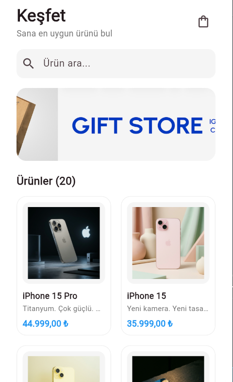
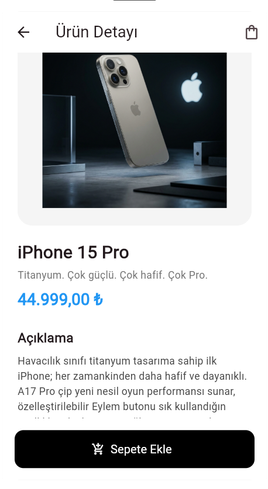
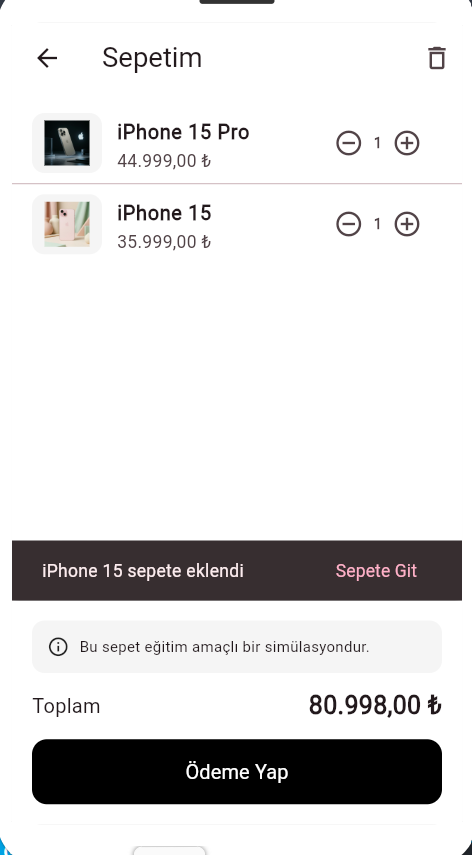
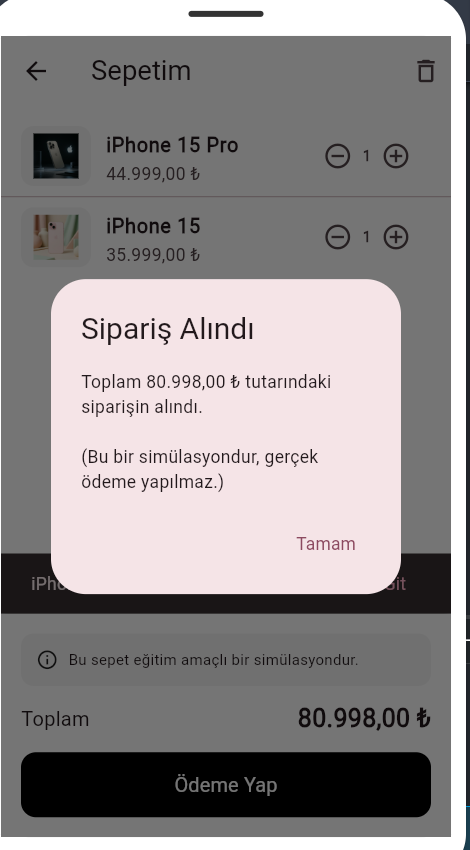
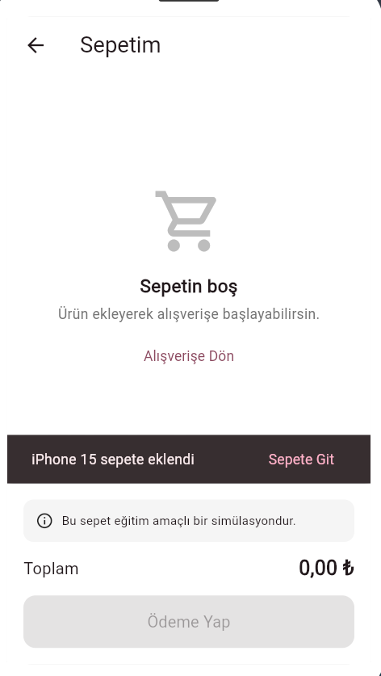

# Mini Katalog Uygulaması

Flutter Günlük Eğitim kapsamında geliştirilmiş, basit fakat profesyonel bir ürün katalog uygulaması.

## Kısa Açıklama

Uygulamada ürünler yerel bir JSON dosyasından (`assets/products.json`) okunur ve 2 sütunlu bir GridView ile listelenir. Kullanıcı ürünleri arayabilir, ürün detayına gidebilir, ürünleri sepete ekleyebilir ve sepette adetleri değiştirebilir. Sepet ve ödeme işlemleri eğitim amaçlı bir **simülasyondur**.

### Özellikler
- Ana sayfa: başlık, arama kutusu, banner, ürün listesi (GridView)
- Basit arama / filtreleme (ürün adı, kategori, alt başlık)
- Ürün detay sayfası (Named Route + Route Arguments ile ürün aktarımı)
- Sepet: ürün ekleme / adet artırma / azaltma / boşaltma (setState ile)
- Boş sepet ekranı
- Hero animasyonu ile sayfa geçişi
- Ekstra paket yok, sadece `material.dart`

### Kullanılan Konular
| Konu | Nerede? |
|---|---|
| Stateless / Stateful widget | `ProductCard` / `HomeScreen`, `CartScreen` |
| Model sınıfı, fromJson / toJson | `lib/models/product.dart` |
| JSON okuma (asset) | `lib/data/product_repository.dart` |
| GridView.builder | `HomeScreen` |
| ListView / ListTile / Card | `CartScreen`, `ProductCard` |
| Navigator.push / pop / popUntil | `ProductDetailScreen`, `CartScreen` |
| Named Routes + Route Arguments | `main.dart`, `HomeScreen` → `ProductDetailScreen` |
| MaterialPageRoute | `ProductDetailScreen` → `CartScreen` |
| State güncelleme (setState) | Sepet işlemleri |

## Proje Klasör Yapısı

```
lib/
├── main.dart                  # Uygulama girişi, tema ve route tanımları
├── app_routes.dart            # Sayfa isimleri (named routes)
├── models/
│   └── product.dart           # Ürün model sınıfı
├── data/
│   ├── product_repository.dart# JSON'dan ürünleri okuma
│   └── cart.dart              # Sepet simülasyonu
├── screens/
│   ├── home_screen.dart       # Ana sayfa
│   ├── product_detail_screen.dart
│   └── cart_screen.dart
└── widgets/
    ├── product_card.dart
    ├── product_image.dart
    └── cart_icon_button.dart
assets/
└── products.json              # Ürün verileri
android/                       # Android platform dosyaları
web/                           # Web platform dosyaları
screenshots/                   # Uygulama ekran görüntüleri
```

## Kullanılan Flutter Sürümü

- Flutter: `3.41`

## Çalıştırma Adımları

```bash
# 1. Projeyi klonla
git clone https://github.com/dagistanyagiz/mini_katalog.git
cd mini_katalog

# 2. Bağımlılıkları yükle
flutter pub get

# 3. Android emülatörü veya cihazı bağla, sonra çalıştır
flutter run
```

> Not: Ürün görselleri internetten yüklendiği için cihazın internet bağlantısı olmalıdır.

## Ekran Görüntüleri

| Ana Sayfa | Ürün Detayı | Sepet |
|---|---|---|
|  |  |  |

| Sipariş (Simülasyon) | Boş Sepet |
|---|---|
|  |  |

## Veri Kaynakları

Bu proje eğitim ve demo amaçlıdır, gerçek bir e-ticaret altyapısını temsil etmez.
- Banner görseli: https://wantapi.com/assets/banner.png (yüklenemezse uygulama kendi banner'ını gösterir)
- Ürün verileri ve görselleri: https://wantapi.com/products.php (açıklamalar Türkçeye çevrildi, fiyatlar temsili TL değerleridir)
